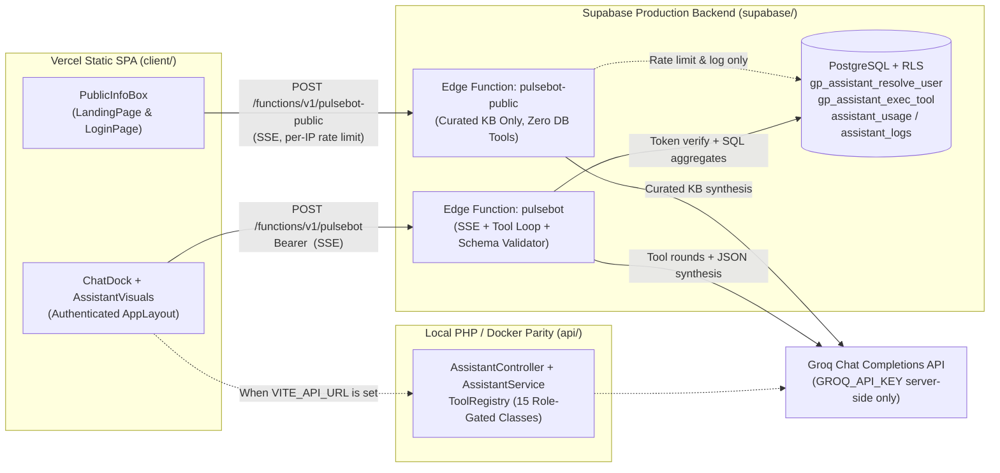

# PulseBot — GridPulse AI Copilot & Public Project Guide

**PulseBot** is GridPulse's role-aware, tool-using, visual AI operations assistant powered by **Groq** (`llama-3.3-70b-versatile`, configurable via `GROQ_MODEL`). It operates across two strictly separated surfaces:

1. **Session Copilot (`pulsebot` / `/api/v1/assistant/chat`)** — Mounted in the authenticated `AppLayout` dock for **Admin**, **Engineer**, and **Viewer** sessions. Answers strictly from GridPulse's live operational database and curated domain documentation, renders server-validated KPI cards, Recharts visualisations (`bar`, `stacked_bar`, `line`, `area`, `pie`, `progress`), tables, operational insights, and verified React Router deep links.
2. **Homepage Info Box (`pulsebot-public` / `/api/v1/assistant/public`)** — Mounted on the public landing page (`/`) and sign-in screen (`/login`). Answers questions about GridPulse, Chitral's renewable fleet problem, role permissions, alert-to-work-order automation, telemetry simulation, demo accounts, and architecture from a curated knowledge base with **zero** access to private operational tables or tools.

---

## 1. Architecture Overview



### Dual-Runtime Parity & Gateway Authentication Note
- **Production (`supabase/` + Vercel):** GridPulse authenticates users against `public.users` (`role`: `admin | engineer | viewer`, `is_active`: `boolean`) using Sanctum-compatible SHA-256 tokens (`<id>|<40-char-hex>`) in `public.personal_access_tokens` (`localStorage['gp_token']`) and Supabase's publishable key (`sb_publishable_...`). Because `gp_token` is a Sanctum token rather than a GoTrue HS256 JWT, `supabase/config.toml` sets `verify_jwt = false` at the Kong gateway layer (matching `[functions.api]`), while `supabase/functions/pulsebot/index.ts` enforces strict token authentication and active-user role resolution on line 1 via `public.gp_assistant_resolve_user(Authorization)`.
- **Identity is never read from the request body:** Any `role` or `user_id` sent in JSON payloads is ignored; identity and RBAC come exclusively from the verified `Authorization` token.
- **Zero browser secrets:** `GROQ_API_KEY` lives exclusively in Supabase Edge Function secrets (and git-ignored local server `.env` files)—never in Vercel or any `VITE_*` variable.

---

## 2. Role Personas & RBAC Matrix

| Capability / Tool | Viewer | Engineer | Admin | Public Info Box |
| --- | :---: | :---: | :---: | :---: |
| `fleet_overview`, `site_summary`, `list_sites`, `list_assets` | ✓ | ✓ | ✓ | — |
| `generation_timeseries`, `energy_report` | ✓ | ✓ | ✓ | — |
| `alerts_summary`, `list_alerts` | ✓ | ✓ | ✓ | — |
| `work_orders_summary`, `work_orders_list` | ✓ (read) | ✓ (defaults to own) | ✓ (all) | — |
| `engineer_workload` | Forbidden | ✓ (self only) | ✓ (any/all) | — |
| `team_summary`, `audit_log_search` | Forbidden | Forbidden | ✓ | — |
| `navigate_targets` (`/team`, `/audit`) | Stripped / Forbidden | Stripped / Forbidden | ✓ | — |
| `project_knowledge` | ✓ | ✓ | ✓ | Curated KB only |
| User email addresses in tool outputs | Redacted | Redacted | Visible | Never |
| Write actions (create/edit/delete/ack/resolve) | Never | Never (links only) | Never (links only) | Never |

---

## 3. Verified Deep-Link Route Whitelist

`navigate_targets` and server-side `ResponseValidator` only allow verified routes defined in `client/src/App.tsx`:

- `/` — Fleet Overview
- `/sites` — `?q=&type=solar|wind|hydro&status=online|degraded|offline|maintenance&view=cards|table`
- `/sites/:id` — `?range=24|72|168` (verified numeric site IDs only)
- `/assets` — `?q=&site_id=&kind=inverter|turbine|panel_string|transformer&status=`
- `/alerts` — `?status=open|acknowledged|resolved|all&severity=critical|warning|info&type=&site_id=`
- `/work-orders` — `?view=board|table&q=&site_id=&mine=1&status=&priority=&types=hydro,solar&assignee_id=&from=YYYY-MM-DD&to=YYYY-MM-DD&overdue=1`
- `/reports` — `?from=YYYY-MM-DD&to=YYYY-MM-DD&group_by=site|type|day`
- `/team` — Admin only
- `/audit` — Admin only (`?page=&action=&q=&from=`)
- `/settings` — Profile & password settings

Any unwhitelisted route emitted by the LLM is rejected by server-side validation, triggering a single correction retry before returning to the client.

---

## 4. Safety, Rate Limiting & Observability

- **Prompt-Injection Defence:** All database text (`work_orders.title`, `description`, `alerts.message`, `sites.name`, `audit_logs.meta`) and user messages are explicitly marked as untrusted data in the system prompt, backed by strict JSON schema and route-whitelist enforcement.
- **Server-Side JSON Contract & 1x Retry:** Responses are validated server-side (`summary`, `kpis[]` max 6, `visuals[]` max 4, table `rows[]` max 10, `insights[]` 1–3, whitelisted `links[]`, `followups[]` 3). Schema failures automatically retry once with `response_format: { type: "json_object" }`, and fail soft to a friendly message with a verified deep link if Groq is unreachable.
- **Rate Limiting (`public.assistant_usage`):**
  - Session Copilot (`pulsebot`): **25 requests / 5 minutes** per authenticated `user_id` (`max 1,500` chars/message).
  - Public Info Box (`pulsebot-public`): **12 requests / 5 minutes** per hashed client IP (`max 600` chars/message).
- **Audit Logging (`public.assistant_logs`):** Records `user_id`, `role`, `surface`, `tools_used`, `tool_rounds`, `latency_ms`, `status`, and `error_code` (no prompts or secrets). Protected by RLS (`assistant_logs_admin_read`) and accessible only to Admins via `GET /api/v1/assistant/logs`.

---

## 5. Deployment Guide (Supabase + Vercel)

### Step 1 — Set Groq Secrets in Supabase
Never add `GROQ_API_KEY` to Vercel or `client/.env`. Store it as an encrypted Supabase Edge Function secret:

```bash
npx supabase login
npx supabase link --project-ref zvrlxhwgmpqpbvzzadrc
npx supabase secrets set GROQ_API_KEY=gsk_your_key_here GROQ_MODEL=llama-3.3-70b-versatile
```

Optional CORS override if adding a custom domain beyond `https://grid-pulse-ruby.vercel.app` and `https://*.vercel.app`:

```bash
npx supabase secrets set ALLOWED_ORIGINS=https://grid-pulse-ruby.vercel.app,https://your-custom-domain.com
```

### Step 2 — Push Database Migration
Applies `supabase/migrations/20261102000000_pulsebot_assistant.sql` (`assistant_usage`, `assistant_logs`, RLS policies, SQL aggregate tools, and `gp_api` filter extensions):

```bash
npx supabase db push
```

### Step 3 — Deploy Both Edge Functions

```bash
npx supabase functions deploy pulsebot
npx supabase functions deploy pulsebot-public
```

### Step 4 — Vercel Frontend Verification
In Vercel Project Settings → Environment Variables, keep **only**:
- `VITE_SUPABASE_URL` = `https://zvrlxhwgmpqpbvzzadrc.supabase.co`
- `VITE_SUPABASE_ANON_KEY` = `<your-supabase-publishable-or-anon-key>`

Confirm **no** `GROQ_API_KEY` or `VITE_GROQ_*` variables exist in Vercel.

---

## 6. Local Development & Testing

### Local Supabase Edge Functions
1. Copy `supabase/.env.example` to git-ignored `supabase/.env.local` and set `GROQ_API_KEY=...`:
   ```bash
   cp supabase/.env.example supabase/.env.local
   ```
2. Serve Edge Functions locally:
   ```bash
   npx supabase start
   npx supabase functions serve --env-file supabase/.env.local
   ```

### Local Laravel 12 API Parity
1. In `api/.env` (git-ignored), set:
   ```env
   GROQ_API_KEY=gsk_your_key_here
   GROQ_MODEL=llama-3.3-70b-versatile
   ```
2. Run migrations and start the server:
   ```bash
   cd api
   php artisan migrate
   php artisan serve
   ```

### Automated Test Suites

```bash
# Backend PHPUnit (role resolution, RBAC on all tools, 6 acceptance scenarios, schema retry, SSE, rate limits)
cd api && php artisan test

# Frontend TypeScript lint, SSR block-rendering test across all chart/table/card types, and production build
cd client && npm run lint && npm run test:assistant && npm run build
```

